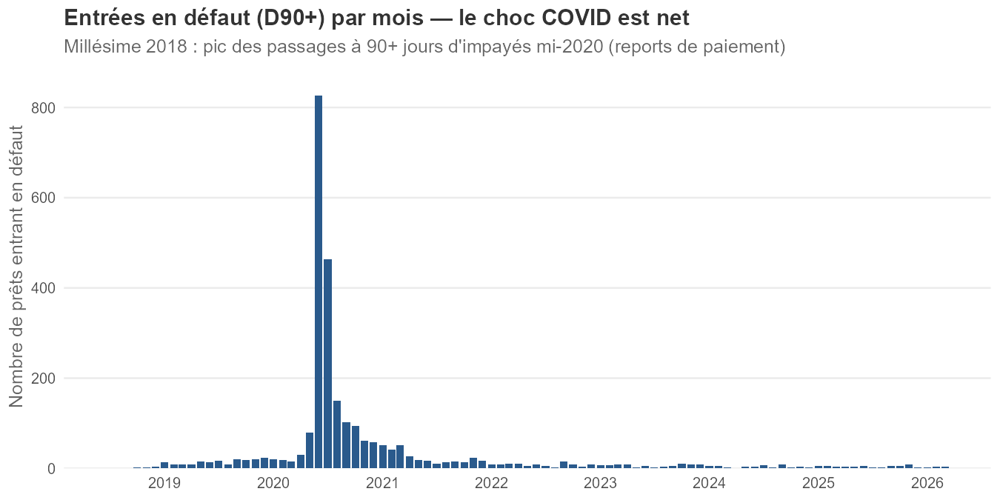
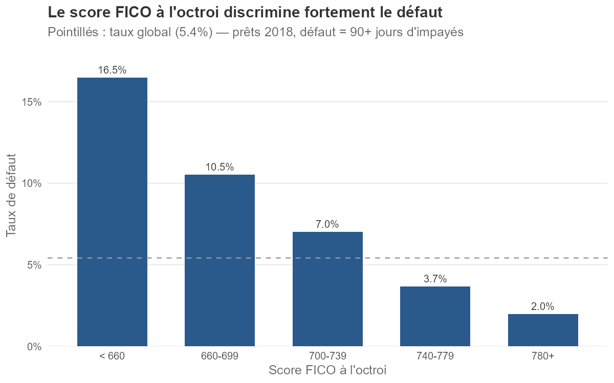
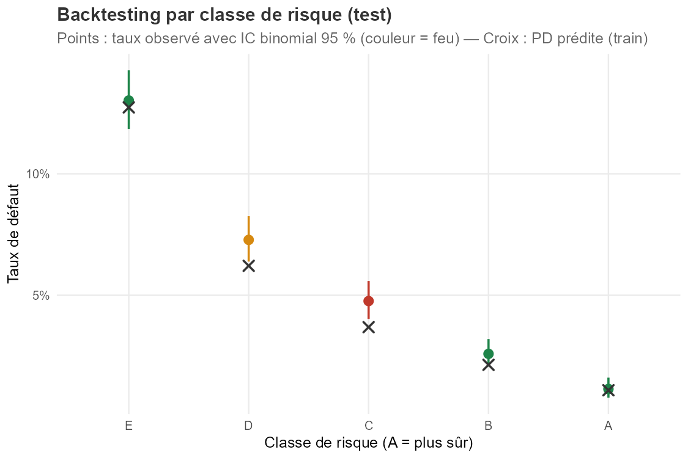

# credit-risk-lab

**Chaîne complète de modélisation du risque de crédit sur données réelles, en R** — scorecard PD, validation de modèle, matrices de transition, analyse de survie, provisionnement IFRS 9 et capital réglementaire (Bâle/IRB).

📄 **Livrable principal : [la note de validation de modèle](rapport/note_validation.Rmd)** (R Markdown reproductible — tous les chiffres sont recalculés depuis le pipeline à chaque compilation).

## Données

[Freddie Mac Single-Family Loan-Level Dataset](https://www.freddiemac.com/research/datasets/sf-loanlevel-dataset) : 50 000 prêts hypothécaires américains originés en 2018, suivis mensuellement jusqu'en mars 2026 (~2 millions de lignes de performance). Définition du défaut : premier passage à 90+ jours d'impayés (D90+), convention absorbante.

Conformément aux conditions d'utilisation de Freddie Mac, **les données brutes ne sont pas redistribuées** (dossier `data/` hors versionnement) — seuls le code et les agrégats le sont. Pour reproduire : compte gratuit Freddie Mac, télécharger `sample_2018.zip`, l'extraire dans `data/raw/`, puis exécuter les scripts dans l'ordre.

## Résultats clés

| Module | Résultat |
|---|---|
| **Scorecard PD** (WoE/IV + logit, 6 variables) | AUC test **0,720** [0,703 ; 0,736], KS 0,33 — grille 600 pts / PDO 50 |
| **Champion vs challenger** | La forêt aléatoire (AUC 0,711) ne bat pas le logit (DeLong p = 0,14) → modèle interprétable retenu |
| **Calibration** | Biais de niveau détecté (HL p = 0,002) → **recalage d'intercept** (δ = +0,112) |
| **Stabilité** | PSI ≤ 0,09 sur toutes les cohortes exploitables (n ≥ 500) |
| **Backtesting** | Test binomial par classe de risque : A/B/E verts, C/D concentrent la sous-prédiction corrigée par le recalage |
| **Matrices de transition** | C→C mensuel 97,4 % ; D60→D90+ 53,1 % ; non-markovianité documentée (ligne D30) |
| **Survie** | Cox C-index **0,728** (cohérent avec l'AUC) ; Schoenfeld rejeté sur le taux d'octroi (refi 2020-21) |
| **IFRS 9 (ECL)** | 159,8 M$ (8,45 % de l'EAD), LGD 25 % — EAD en capital restant dû (formule d'annuité) |
| **Capital (IRB vs standard)** | Densité RWA 35,0 % vs 33,8 % — output floor Bâle III non mordant sur ce portefeuille |

### Le choc COVID, fil rouge du millésime 2018

Les entrées en défaut se concentrent sur 2020 (pic : 827 prêts en juin), effet des reports de paiement (*forbearance*) :

Le score discrimine fortement dès l'octroi (défaut ×8,3 entre FICO < 660 et ≥ 780) :

## Constats méthodologiques (débogués sur données réelles)

- **Troncature à droite des matrices de transition** : un prêt remboursé sort du fichier ; sans complétion du panel après absorption, la matrice annuelle sous-estime massivement les transitions vers P et D90+ (C→P : 2,4 % → 24,4 % après correction).
- **Non-markovianité** : un prêt passé par D30 guérit moins et défaute plus que ne le prédit la chaîne homogène (M¹² vs annuelle empirique) — l'impayé passé est une information, argument pour les approches par durées.
- **PSI sur petits effectifs** : des cohortes de < 50 prêts produisaient des PSI > 8 — du pur bruit d'échantillonnage ; seuil d'effectif minimal imposé (n ≥ 500).
- **AUC train = 1,000 de la forêt aléatoire** : artefact classique des forêts en probabilité — la métrique honnête est l'erreur OOB.
- **Biais d'importance** : `orig_upb` (IV négligeable) bondit en 2ᵉ position d'importance RF — biais des variables continues dans l'importance par impureté ; d'où la lecture croisée IV / importance.

## Pipeline

| Script | Contenu |
|---|---|
| `01_data_prep.R` | Lecture des fichiers bruts (pipe, sans en-têtes), contrôles de cohérence, cible D90+, panel mensuel |
| `02_exploration.R` | Taux de défaut par segment, chronologie COVID, vintage curve |
| `03_scorecard_pd.R` | WoE/IV, logit champion, grille de score (600 pts, PDO 50) |
| `04_challenger_ml.R` | Forêt aléatoire, test de DeLong, importances |
| `05_validation.R` | AUC/IC, KS, calibration (Hosmer-Lemeshow), PSI, backtesting binomial par classe |
| `06_transitions.R` | Matrices mensuelle et annuelle (cohorte, panel complété), contrôle d'homogénéité M¹² |
| `07_survie.R` | Kaplan-Meier par FICO, Cox (hazard ratios), diagnostic de Schoenfeld |
| `08_provisionnement.R` | Recalage d'intercept, EAD par annuité, staging 1/2/3, ECL, sensibilité LGD |
| `09_capital_bale.R` | IRB (WCDR, ρ = 0,15), approche standard par LTV, output floor |

## Environnement

R ≥ 4.4 — `data.table`, `tidyverse`, `scorecard`, `pROC`, `ranger`, `survival`, `rmarkdown`.

## Limites assumées

Un seul millésime (pas d'out-of-time inter-millésimes) ; définition du défaut sensible au traitement de la forbearance COVID ; censure informative en survie (extension : Fine-Gray) ; LGD paramétrique. Détail et recommandations : voir la [note de validation](rapport/note_validation.Rmd).

## Auteur

**Guillaume Bousson** — M2 Statistique et économétrie (Université de Strasbourg) · M1 Finance (IAE Lille)
Projet compagnon : [fan360](https://github.com/GuillaumeBousson/fan360) (scoring et analyse de données clients, Python/SQL)
