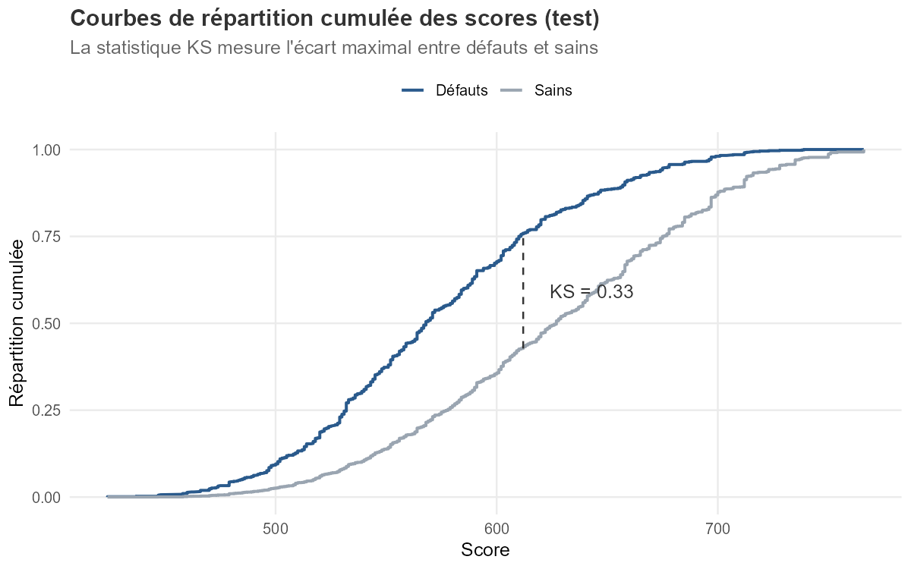
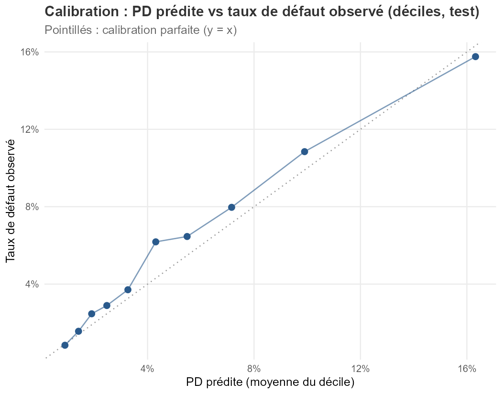

```{r setup, include=FALSE}
knitr::opts_chunk$set(echo = FALSE, warning = FALSE, message = FALSE)
knitr::opts_knit$set(root.dir = normalizePath(".."))
library(data.table)
library(scales)
```

```{r donnees}
loans    <- readRDS("data/loans.rds")
backtest <- readRDS("data/backtest.rds")
mats     <- readRDS("data/matrices_transition.rds")
scored   <- readRDS("data/scored_test.rds")
psi      <- fread("outputs/psi_cohortes.csv")
iv_ok    <- file.exists("outputs/bins_woe.csv")
```

# 1. Objet et périmètre

Cette note présente la construction et la validation d'un modèle de probabilité
de défaut (PD) de type *scorecard* sur un portefeuille de
`r format(nrow(loans), big.mark = " ")` prêts hypothécaires américains originés
en 2018 (échantillon public Freddie Mac *Single-Family Loan-Level Dataset*),
observés mensuellement de janvier 2018 à mars 2026. Elle couvre l'ensemble du
cycle de vie du modèle : spécification, estimation, validation (discrimination,
calibration, stabilité, *backtesting*), et usages aval (provisionnement type
IFRS 9, capital réglementaire IRB).

L'ensemble du dispositif est reproductible : neuf scripts R exécutables en
séquence, publiés sur [GitHub](https://github.com/GuillaumeBousson/credit-risk-lab) ;
les chiffres de cette note sont recalculés à chaque compilation à partir des
objets produits par le pipeline.

# 2. Données et définition du défaut

**Définition du défaut** : premier passage à 90 jours d'impayés ou plus (D90+),
en ligne avec les standards bâlois. Convention *absorbante* : un prêt entré en
défaut y demeure, même en cas de guérison ultérieure.

```{r synthese-portefeuille}
tab <- loans[, .N, by = outcome][order(-N)]
tab[, part := percent(N / sum(N), accuracy = 0.1)]
setnames(tab, c("Issue du prêt", "Nombre", "Part"))
knitr::kable(tab, format.args = list(big.mark = " "),
             caption = sprintf(
  "Issues observées (fenêtre 2018-2026). Taux de défaut vie entière : %.2f %%.",
  100 * mean(loans$default_90)))
```

Le taux de défaut vie entière (`r sprintf("%.2f %%", 100 * mean(loans$default_90))`)
intègre le choc COVID : les entrées en défaut se concentrent massivement sur
2020 (pic à 827 prêts en juin 2020), en lien avec les dispositifs de report de
paiement (*forbearance*). Ce point conditionne la lecture de l'ensemble des
niveaux de PD de la note.


# 3. Méthodologie

- **Partition** : 70 % apprentissage / 30 % test (graine fixée), même partition
  pour tous les modèles.
- **Discrétisation WoE** et sélection par *Information Value* (seuil 0,02) :
  6 variables retenues sur 11 candidates — FICO (IV = 0,51), DTI, taux à
  l'octroi, LTV, nombre d'emprunteurs, primo-accession. Toutes les variables
  sont connues **à l'octroi** : le score est utilisable au moment de la décision
  de crédit.
- **Modèle champion** : régression logistique sur variables WoE, convertie en
  grille de score (ancrage 600 points, PDO = 50).
- **Modèle challenger** : forêt aléatoire (500 arbres) sur variables brutes.

# 4. Résultats de validation

## 4.1 Discrimination

```{r discrimination}
disc <- data.table(
  Indicateur = c("AUC (test)", "IC 95 % (DeLong)", "Gini (test)",
                 "KS (test)", "C-index Cox (cohérence inter-approches)"),
  Valeur = c("0,720", "[0,703 ; 0,736]", "0,439", "0,33 (score 612)", "0,728"))
knitr::kable(disc)
```

Le pouvoir discriminant est conforme aux standards d'une scorecard hypothécaire
à l'octroi. Le challenger (forêt aléatoire) obtient une AUC test de 0,711,
**inférieure** au champion ; le test de DeLong ne rejette pas l'égalité
(p = 0,14). Le modèle interprétable est donc retenu sans coût de performance —
l'auditabilité et la stabilité l'emportent.



## 4.2 Calibration

La PD moyenne prédite sur l'échantillon test (5,26 %) sous-estime le taux
observé (5,82 %) ; le test de Hosmer-Lemeshow rejette la calibration parfaite
(χ² = 23,98, p = 0,002). Ce biais de **niveau** — le classement n'est pas en
cause — provient de l'aléa de partition (taux de défaut train : 5,24 %).

**Action corrective appliquée** : recalage d'intercept (δ = +0,112), qui aligne
la PD moyenne sur le taux observé hors apprentissage sans modifier la
discrimination. Les PD recalées alimentent le provisionnement (§ 5).



## 4.3 Stabilité des populations (PSI)

```{r psi}
tab_psi <- psi[, .(Cohorte = trimestre, PSI = round(psi, 3), Statut = statut)]
knitr::kable(tab_psi,
             caption = "PSI des scores par cohorte d'origination (référence : 2018-T1). Cohortes d'effectif < 500 exclues — un PSI sur quelques dizaines de prêts ne mesure que du bruit d'échantillonnage.")
```

Toutes les cohortes exploitables sont stables (PSI max = `r round(max(psi$psi), 3)`,
seuil d'alerte usuel : 0,25).

## 4.4 Backtesting par classe de risque

Les scores sont regroupés en cinq classes (quintiles d'apprentissage, A = plus
sûr). Pour chaque classe, un test binomial exact confronte le nombre de défauts
observés (test) à la PD de référence (apprentissage).

```{r backtest}
bt <- backtest[, .(Classe = classe, Effectif = n, Défauts = defauts,
                   `PD prédite` = percent(pd_classe, accuracy = 0.01),
                   `Taux observé` = percent(taux_observe, accuracy = 0.01),
                   `p-value` = round(p_value, 3), Feu = feu)]
knitr::kable(bt, caption = "Backtesting binomial par classe de risque (échantillon test).")
```

Les classes extrêmes (A, B, E) sont validées ; les classes intermédiaires C
(rouge) et D (orange) concentrent la sous-prédiction identifiée en § 4.2 — le
recalage d'intercept répond à ce constat.


# 5. Usages aval

- **Matrices de transition** (approche cohorte, panel complété après
  absorption) : persistance mensuelle C→C de 97,4 %, bascule D60→D90+ de
  53,1 %. L'écart entre la matrice annuelle empirique et la puissance 12^e^ de
  la matrice mensuelle — concentré sur la ligne D30 — met en évidence une
  dépendance de trajectoire (un prêt passé par l'impayé reste durablement plus
  risqué) : hypothèse markovienne homogène non vérifiée, plaidoyer pour les
  approches par durées.
- **Analyse de survie** : modèle de Cox cohérent avec la scorecard
  (C-index 0,728) ; hasards proportionnels rejetés pour le taux à l'octroi
  (Schoenfeld, p ≈ 10⁻²²), cohérent avec la vague de refinancement 2020-2021.
- **Provisionnement type IFRS 9** (PD recalées × LGD 25 % × EAD en capital
  restant dû) : ECL totale de 159,8 M$ (8,45 % de l'EAD), dominée par le
  Stage 3. Sensibilité forte à la LGD (95,9 M$ à 15 % ; 255,7 M$ à 40 %) : la
  LGD est l'hypothèse dominante du dispositif.
- **Capital réglementaire** (IRB hypothécaire, ρ = 0,15 ; périmètre sain) :
  densité de RWA de 35,0 %, contre 33,8 % en approche standard — un IRB
  au-dessus du standard, conséquence des PD marquées par le choc COVID ;
  l'*output floor* de Bâle III (72,5 %) n'est pas mordant ici.

# 6. Limites et recommandations

**Limites assumées** :

1. Un seul millésime (2018) : pas de validation *out-of-time* inter-millésimes ;
   la stabilité n'est contrôlée qu'en intra-millésime (PSI).
2. Définition du défaut sensible au traitement de la *forbearance* COVID — les
   niveaux de PD sont spécifiques à cette fenêtre d'observation.
3. Censure informative en analyse de survie (remboursements anticipés traités
   en censure simple) — extension naturelle : risques concurrents (Fine-Gray).
4. LGD paramétrique (25 %), non modélisée sur données de pertes.
5. Stage 3 cumulant huit années de défauts (convention absorbante) : la photo
   surpondère le stock de défauts par rapport à un bilan bancaire réel.

**Recommandations** :

1. Étendre l'estimation à plusieurs millésimes (2015-2021) pour une validation
   *out-of-time* et une PD moyenne de cycle (*through-the-cycle*).
2. Modéliser la LGD sur les données de liquidation du fichier de performance.
3. Mettre sous surveillance trimestrielle : PSI, backtesting par classe,
   dérive de calibration (recalage périodique de l'intercept).
4. Documenter le traitement *forbearance* dans la définition du défaut en cas
   d'usage hors exercice pédagogique.

---

*Note produite avec R Markdown — pipeline complet et reproductible :
[github.com/GuillaumeBousson/credit-risk-lab](https://github.com/GuillaumeBousson/credit-risk-lab)*
